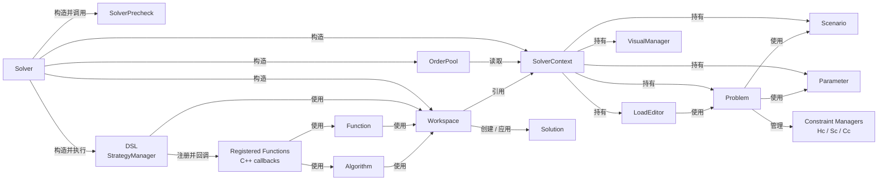

# 项目框架简介

## 关联关系

箭头方向表示依赖或使用关系，即 `A --> B` 表示 `A` 依赖或使用 `B`。实线表示当前代码可验证的生命周期关系或主调用链，虚线表示尚未实现的设计目标。

## 分层约定：Lua 只到策略层

- **策略层 `solver/`**：唯一读取 Lua 配置的地方。`stra_alns_config` 负责把 `alns { ... }`
  配置转换成结构化参数（`AlnsStrategyConfig`、各算子的 `*Param`），包括键名、类型读取、
  算子 `code` 分发与缺省字段补齐。
- **算法层 `algorithm/`**：只接收 POD 参数，不依赖 `sol2` / `lua`；参数之间的语义校验
  （如比例区间、`min <= max`、`noise_exponent >= 1`）留在算子构造函数里。

新增算子参数时：在算子头文件定义 `*Param`，加入 `AlnsRuinOperatorParam` /
`AlnsRepairOperatorParam` variant，并在 `solver/src/stra_alns_config.cpp` 补上对应的
Lua 字段名与解析分支。Lua 配置面（键名、算子 code、默认值）以
[dsl_user_guide.md](dsl_user_guide.md) 为准。
